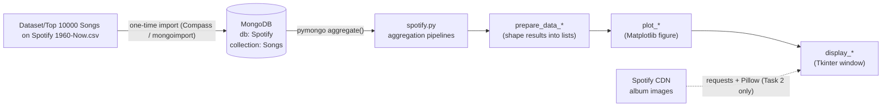

# Spotify Data Analysis with MongoDB (NoSQL)

A desktop data-analysis app that explores **10,000 of the most popular Spotify tracks (1960 – now)** stored in **MongoDB**. Each analysis is a MongoDB **aggregation pipeline**; the results are plotted with **Matplotlib** and shown in a **Tkinter** GUI.

The project was built for a Master's-level Database Systems course to show how a document database can answer analytical questions about music popularity, audio features, record labels and release timing.

---

## Table of Contents

- [Features](#features)
- [How It Works](#how-it-works)
- [Repository Structure](#repository-structure)
- [Dataset](#dataset)
- [Tech Stack](#tech-stack)
- [Setup](#setup)
- [Running the App](#running-the-app)
- [The Four Analyses in Detail](#the-four-analyses-in-detail)
- [Code Walkthrough](#code-walkthrough)
- [Known Limitations](#known-limitations)

---

## Features

| # | Analysis | Question it answers | Chart |
|---|----------|---------------------|-------|
| 1 | **Trend Analysis** | Do more popular songs tend to be more danceable or energetic? | Bars (danceability) + line (energy) by popularity range |
| 2 | **Label Comparison** | How do the 10 labels with the highest average popularity compare on "energy & rhythm" vs. "vocal & instrumental" traits? | Grouped bars + a scrollable list with album art |
| 3 | **Release Timing Impact** | Does the weekday a track is released relate to its tempo, energy and popularity? | Bars (tempo) + two lines (energy, popularity) on three y-axes |
| 4 | **Duration vs. Popularity** | How have average track length and popularity changed over the years? | Two scatter series on twin y-axes, by release year |

---

## How It Works



1. **Import** – the CSV is loaded once into the `Songs` collection of the `Spotify` database on a local MongoDB server.
2. **Launch** – `python spotify.py` connects to `mongodb://localhost:27017/` and opens a small Tkinter window with four radio buttons and a **Run Query** button.
3. **Query** – choosing an analysis and clicking **Run Query** runs that analysis's aggregation pipeline on the server.
4. **Prepare → Plot → Display** – the results are turned into Python lists, drawn as a Matplotlib figure, and put in a new Tkinter `Toplevel` window via `FigureCanvasTkAgg`. Several result windows can be open at once.

---

## Repository Structure

```
Spotify-Data-Analysis-NoSQL/
├── Dataset/
│   └── Top 10000 Songs on Spotify 1960-Now.csv   # Source data (~6.8 MB, 9,999 tracks, 35 columns)
├── spotify.py                                    # The whole app: DB connection, pipelines, plots, GUI
├── requirements.txt                              # Python dependencies
├── .gitignore                                    # Ignores IDE files, venvs, reports (.pdf/.docx)
└── README.md
```

---

## Dataset

**File:** `Dataset/Top 10000 Songs on Spotify 1960-Now.csv`: 9,999 tracks, 35 columns, about 1,470 distinct record labels.

Columns used by the app:

| Column | Used in | Description |
|--------|---------|-------------|
| `Popularity` | 1, 2, 3, 4 | Spotify popularity score (0–100) |
| `Danceability`, `Energy` | 1, 2, 3 | Audio features (0.0–1.0) |
| `Speechiness`, `Acousticness`, `Liveness` | 2 | Audio features used in the composite scores |
| `Loudness`, `Instrumentalness`, `Valence` | 2 | Averaged per label (computed, not plotted) |
| `Tempo` | 2, 3 | Beats per minute |
| `Track Duration (ms)` | 4 | Track length in milliseconds |
| `Album Release Date` | 3, 4 | Mostly `M/D/YYYY`; some rows have only a year (`YYYY`) or `YYYY-MM` |
| `Label` | 2 | Record label (the group key) |
| `Track Name`, `Artist Name(s)`, `Album Name`, `Album Image URL`, `Copyrights` | 2 | Details shown in the label list |

Other columns (track/artist/album URIs, ISRC, genres, key, mode, time signature, etc.) are kept in the documents but not used by the analyses.

---

## Tech Stack

- **Python 3.x**
- **MongoDB** Community Server (local, port `27017`)
- **pymongo**: MongoDB driver
- **matplotlib**: charts (embedded in Tk with `FigureCanvasTkAgg`)
- **tkinter**: GUI (included with most Python installs)
- **requests** + **Pillow**: download and resize album artwork (Task 2)

---

## Setup

### 1. Install and start MongoDB

Install [MongoDB Community Server](https://www.mongodb.com/try/download/community) and make sure it is running on `localhost:27017`.

### 2. Import the dataset

The app expects a database named **`Spotify`** with a collection named **`Songs`**.

**Option A: MongoDB Compass (GUI)**

1. Connect to `mongodb://localhost:27017`.
2. Click **+** to create a database: Database name `Spotify`, Collection name `Songs`.
3. Open `Spotify` → `Songs`, then **Add Data** → **Import File**.
4. Select `Dataset/Top 10000 Songs on Spotify 1960-Now.csv`, choose **CSV**, and click **Import**.

**Option B: `mongoimport` (command line)**

```bash
mongoimport --uri "mongodb://localhost:27017" --db Spotify --collection Songs --type csv --headerline --file "Dataset/Top 10000 Songs on Spotify 1960-Now.csv"
```

> Numeric columns (`Popularity`, `Energy`, `Tempo`, …) must be imported as **numbers**, not strings, or `$avg` will return `null`. Both Compass and `mongoimport` detect the types on their own.

### 3. Install Python dependencies

```bash
pip install -r requirements.txt
```

On some Linux distributions Tkinter is a separate package (for example `sudo apt install python3-tk`).

---

## Running the App

```bash
python spotify.py
```

1. Choose one of the four analyses with the radio buttons.
2. Click **Run Query**.
3. A new window opens with the chart (and, for Label Comparison, a scrollable list of labels with album artwork).

---

## The Four Analyses in Detail

### Task 1: Trend Analysis (`trend_relationship`)

Groups tracks into popularity buckets of 10 and averages danceability and energy in each bucket.

```js
{ $group: { _id: { $floor: { $divide: ["$Popularity", 10] } },
            averageDanceability: { $avg: "$Danceability" },
            averageEnergy:       { $avg: "$Energy" } } },
{ $sort: { _id: 1 } }
```

Bucket `0` = popularity 0–9, `1` = 10–19, … `10` = 100. The chart shows danceability as blue bars (left axis) and energy as a red line (right axis).

### Task 2: Label Comparison (`label_comparison_enhanced`)

1. **`$group` by `Label`**: averages popularity and all audio features, and collects one sample track, album, image URL and copyright with `$first`, plus the set of artists (`$addToSet`) and a track count.
2. **`$sort`** by average popularity (descending) and **`$limit`** to the top 10 labels.
3. **`$addFields`** computes two weighted composite scores:

   | Score | Formula |
   |-------|---------|
   | **Energy & Rhythm** | `0.6 × Energy + 0.4 × Danceability` |
   | **Vocal & Instrumental** | `0.4 × Speechiness + 0.8 × Liveness + 0.2 × Acousticness` |

The chart shows both scores as side-by-side bars for labels numbered 1–10. Below it, a scrollable panel lists each label's sample track, artists, album and average popularity, with the album cover downloaded from Spotify's CDN and resized to 100×100. This step needs an internet connection; if it is offline, the images are skipped.

### Task 3: Release Timing Impact (`release_timing_impact`)

1. Keeps only documents whose `Album Release Date` is a string.
2. Parses it with `$dateFromString` using the format `%m/%d/%Y`; rows that fail to parse are tagged `"Invalid Date"` (`onError`) and filtered out.
3. Gets the weekday with `$dayOfWeek` (1 = Sunday … 7 = Saturday).
4. Groups by weekday and averages tempo, energy and popularity.

The chart has three y-axes: tempo as orange bars, energy as a purple line, and popularity as a blue line on an offset third axis.

### Task 4: Track Duration vs. Popularity (`duration_popularity_correlation`)

1. Converts `Album Release Date` to a date with `$toDate` (only when the field is a string; otherwise `null`).
2. Drops documents without a date.
3. Groups by `$year` and averages popularity and `Track Duration (ms)`.

The chart shows popularity (red, left axis) and duration (blue, right axis) as scatter series by year.

---

## Code Walkthrough

All logic is in `spotify.py`. Each analysis uses the same four steps: **query → prepare → plot → display**.

| Function | Role |
|----------|------|
| `mongodb_connection_spotify()` | Connects to local MongoDB and returns the `Spotify.Songs` collection |
| `trend_relationship()` / `prepare_data_trend_relationship()` / `plot_trend_relationship()` / `display_trend_relationship()` | Task 1 |
| `label_comparison_enhanced()` / `prepare_data_label_comparison_enhanced()` / `plot_label_comparison_enhanced()` / `display_label_comparison_enhanced()` | Task 2 (the display also builds the scrollable label list and loads the images) |
| `release_timing_impact()` / `prepare_data_release_timing_impact()` / `plot_release_timing_impact()` / `display_release_timing_impact()` | Task 3 |
| `duration_popularity_correlation()` / `prepare_data_display_popularity_correlation()` / `plot_duration_popularity_correlation()` / `display_popularity_correlation()` | Task 4 |
| `display_result_tk()` | Main window: radio buttons, the **Run Query** button, and the code that runs the selected task |
| `main()` | Entry point: connects to the DB and starts the GUI |

---

## Known Limitations

- **Hard-coded connection**: the MongoDB URI (`mongodb://localhost:27017/`), database name and collection name are fixed in `mongodb_connection_spotify()`.
- **Date formats**: Task 3 only parses `M/D/YYYY` dates, so release dates that are only a year or `YYYY-MM` (about 14% of rows) are left out. Task 4 depends on `$toDate` being able to parse the date strings; if the aggregation fails on your MongoDB version, use `$dateFromString` with `onError`, as Task 3 does.
- **Image-loading errors**: the error message in Task 2's image loader uses `album['Label']`, which is not a field in the grouped results (the label is in `_id`), so a failed download raises a `KeyError` instead of printing a warning.
- **Label axis**: Task 2's chart numbers the labels 1–10; the matching label names are in the list below the chart.
- **`.gitignore` encoding**: the file is saved as UTF-16 with CRLF line endings, which Git may not read correctly. Re-saving it as UTF-8 makes sure its rules take effect.
